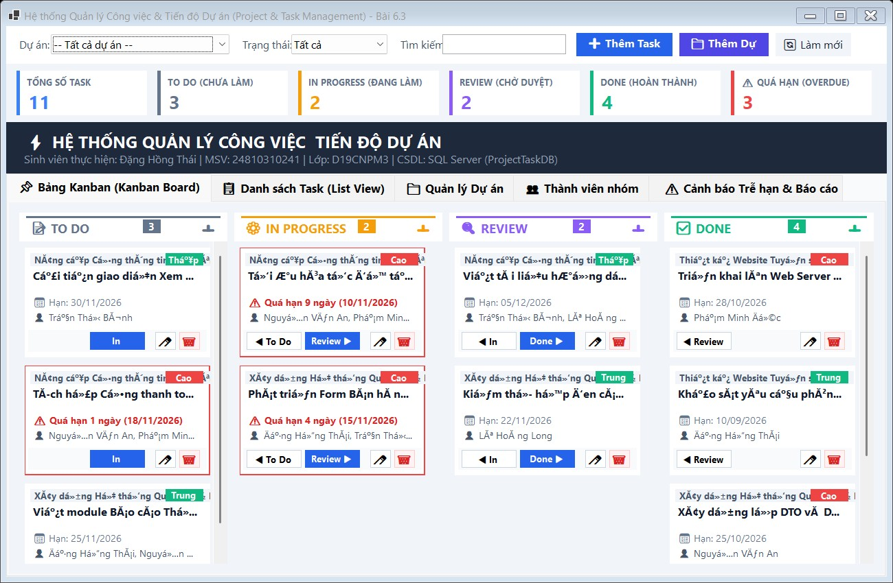
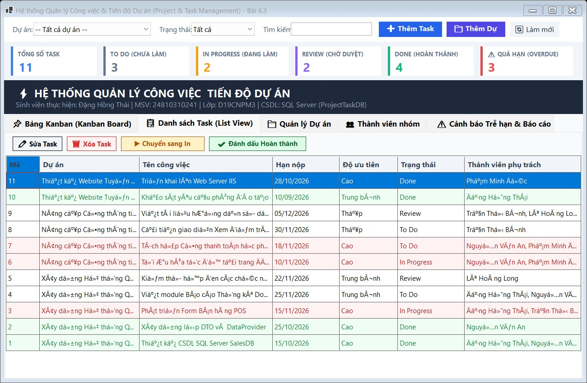
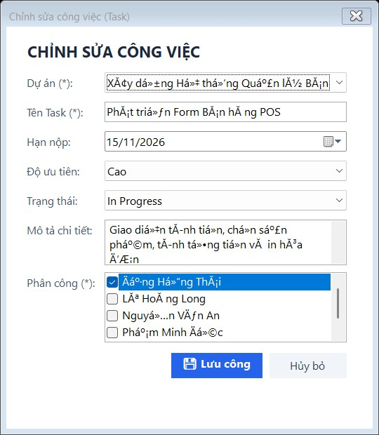
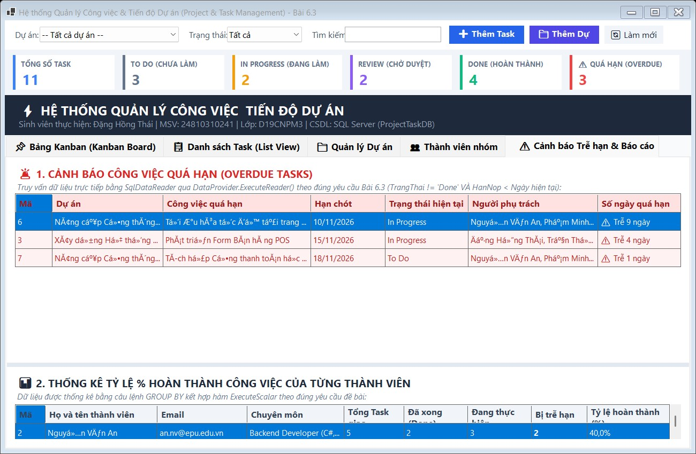
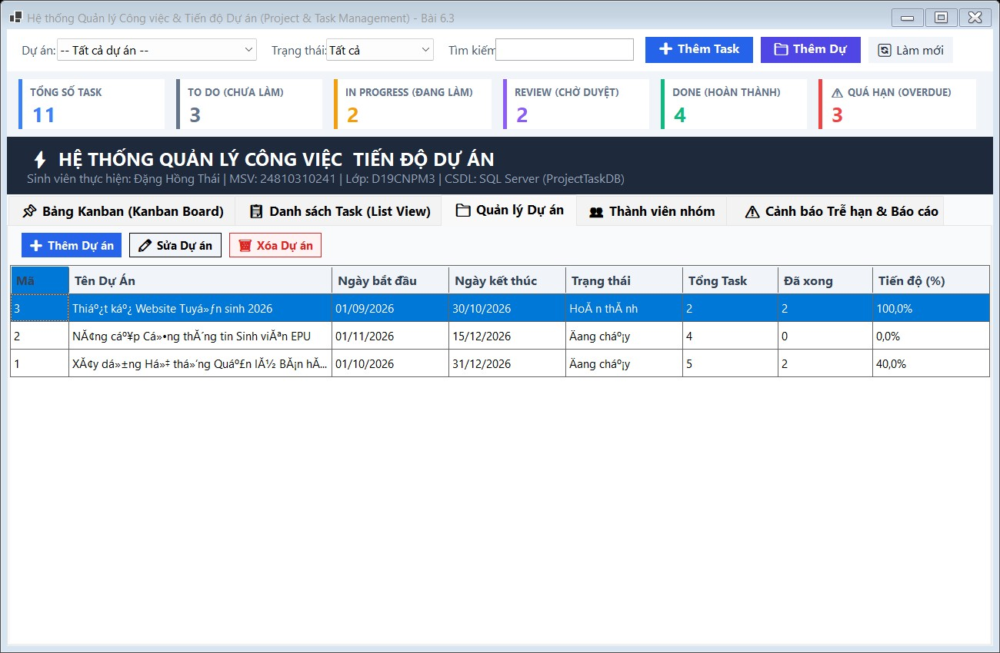
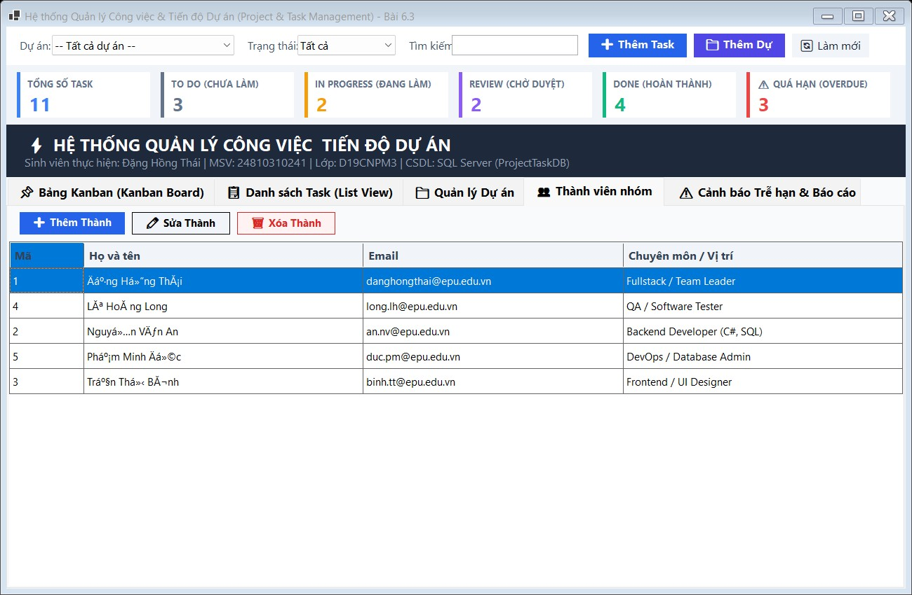

# BÁO CÁO THỰC HÀNH BUỔI 6: BÀI 6.3, 6.4 & 6.5
## MÔN HỌC: LẬP TRÌNH .NET

---

## MỤC 1: THÔNG TIN SINH VIÊN

- **Họ và tên sinh viên:** Đặng Hồng Thái
- **Mã sinh viên:** 24810310241
- **Lớp / Khóa:** D19CNPM3
- **Trường:** Đại học Điện Lực (EPU)

---

## BÀI 6.3: HỆ THỐNG QUẢN LÝ CÔNG VIỆC & TIẾN ĐỘ DỰ ÁN (PROJECT & TASK MANAGEMENT)

### 1. Kiến trúc hệ thống 3-Tier Layered chuẩn
Ứng dụng được thiết kế phân lớp hoàn chỉnh:
- **DTO (Data Transfer Object):** `DuAnDTO`, `ThanhVienDTO`, `CongViecDTO`, `PhanCongDTO`, `ThongKeThanhVienDTO`.
- **DAL (Data Access Layer):** 
  - `DataProvider.cs`: Kết nối CSDL SQL Server `ProjectTaskDB`, hỗ trợ Parameterized SQL chống SQL Injection, `ExecuteQuery`, `ExecuteNonQuery`, `ExecuteScalar`, `ExecuteReader`.
  - `DuAnDAL.cs`, `ThanhVienDAL.cs`: Quản trị CRUD dự án và nhân sự.
  - `CongViecDAL.cs`: Lọc task theo dự án & trạng thái; Chuyển trạng thái qua Parameterized SQL Update; Truy vấn task quá hạn bằng `SqlDataReader`.
  - `PhanCongDAL.cs`: Giao việc cho 1 hoặc nhiều thành viên dùng Transaction.
  - `BaoCaoDAL.cs`: Thống kê tỷ lệ % hoàn thành theo từng thành viên qua câu lệnh `GROUP BY` và hàm `ExecuteScalar`.
- **BUS (Business Logic Layer):** Kiểm tra toàn vẹn nghiệp vụ, ràng buộc email, ngày tháng, trạng thái trước khi gửi xuống DAL.
- **GUI (Graphical User Interface):** Windows Forms hiện đại, tích hợp cả giao diện **Kanban Board** trực quan và **List View**.

---

### 2. Hình ảnh kết quả các màn hình chức năng

#### 2.1. Màn hình Kanban Board (Kéo / Chuyển trạng thái nhanh)
Hiển thị 4 cột: **To Do**, **In Progress**, **Review**, **Done** kèm thẻ công việc, huy hiệu độ ưu tiên, người phụ trách và nút chuyển trạng thái tức thì.

#### 2.2. Màn hình Danh sách Công việc (List View)
Hiển thị bảng chi tiết, bộ lọc theo Dự án, Trạng thái, tìm kiếm từ khóa, tô màu task hoàn thành (xanh lá) và task quá hạn (đỏ).

#### 2.3. Màn hình Thêm / Chỉnh sửa Task & Phân công thành viên
Cho phép phân công một hoặc nhiều thành viên phụ trách cùng một công việc qua CheckedListBox.

#### 2.4. Màn hình Cảnh báo Trễ hạn (SqlDataReader) & Báo cáo Thống kê (ExecuteScalar / GROUP BY)
- **Phần 1 - Cảnh báo trễ hạn:** Dùng `SqlDataReader` hiển thị danh sách các task quá hạn (`HanNop < GETDATE() AND TrangThai != 'Done'`) cùng số ngày trễ hạn.
- **Phần 2 - Báo cáo thống kê:** Thống kê tỷ lệ % hoàn thành của từng thành viên trong dự án bằng câu lệnh `GROUP BY` và hàm `ExecuteScalar`.

#### 2.5. Màn hình Quản lý Dự án
CRUD thông tin dự án, tính toán tiến độ tổng thể (% hoàn thành) của từng dự án.

#### 2.6. Màn hình Quản lý Thành viên
CRUD danh sách nhân sự, phân vai trò, chuyên môn và email.

---

### 3. Hướng dẫn chạy chương trình
1. **Khởi tạo CSDL:** Mở SQL Server Management Studio (SSMS) và chạy file `Database\ScriptDB_ProjectTaskDB.sql` (hoặc chạy lệnh `sqlcmd -S .\SQLEXPRESS -E -i "Database\ScriptDB_ProjectTaskDB.sql"`).
2. **Mở dự án:** Mở file `Bai_6_3_6_4_6_5.slnx` hoặc `ProjectTaskManager\ProjectTaskManager.csproj` trong Visual Studio 2022 / 2025 hoặc chạy lệnh `dotnet run --project ProjectTaskManager`.
