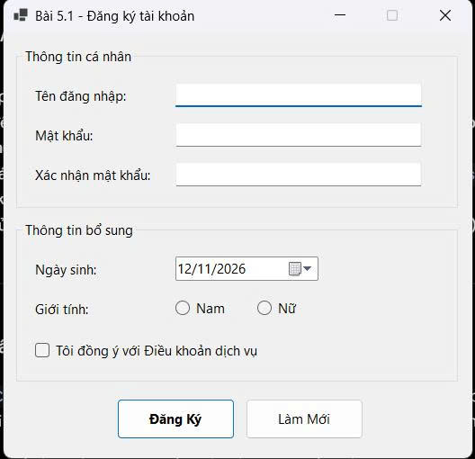
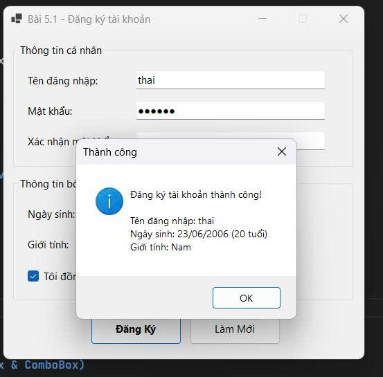
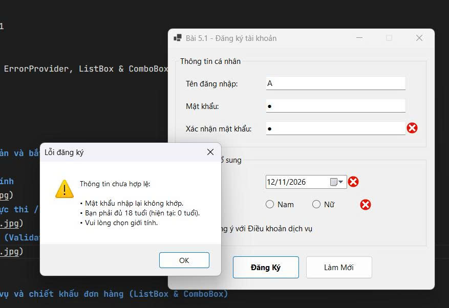
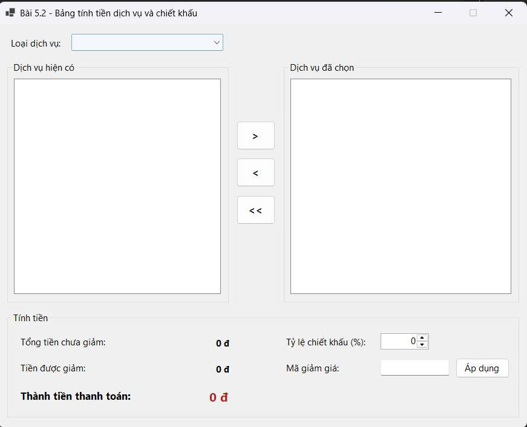
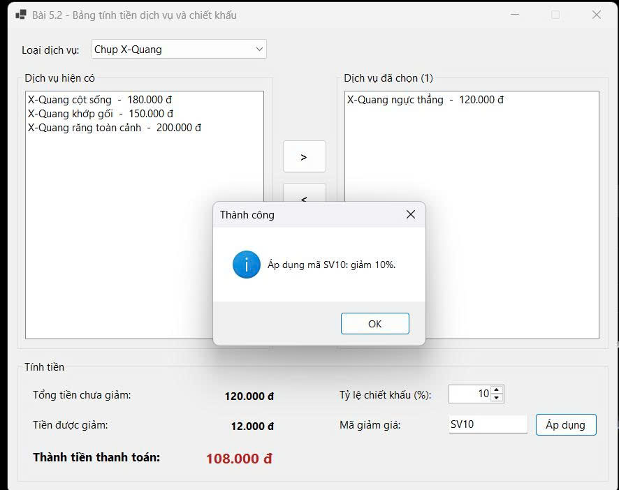
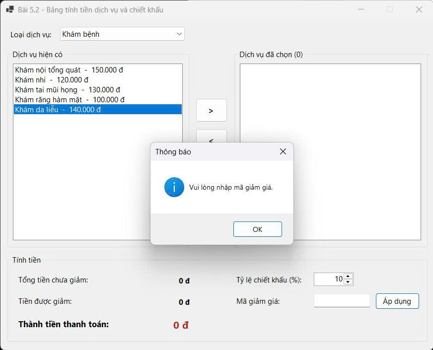
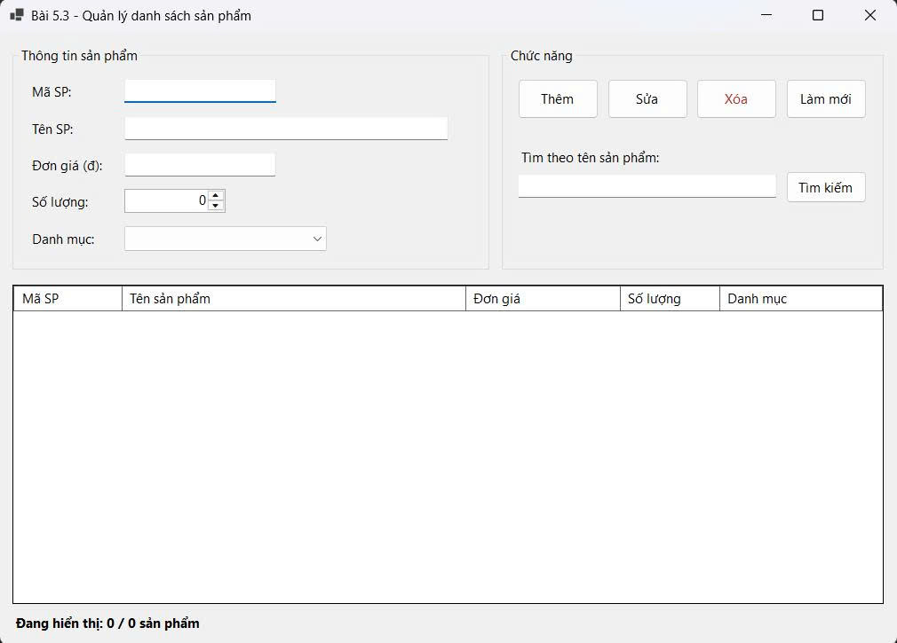
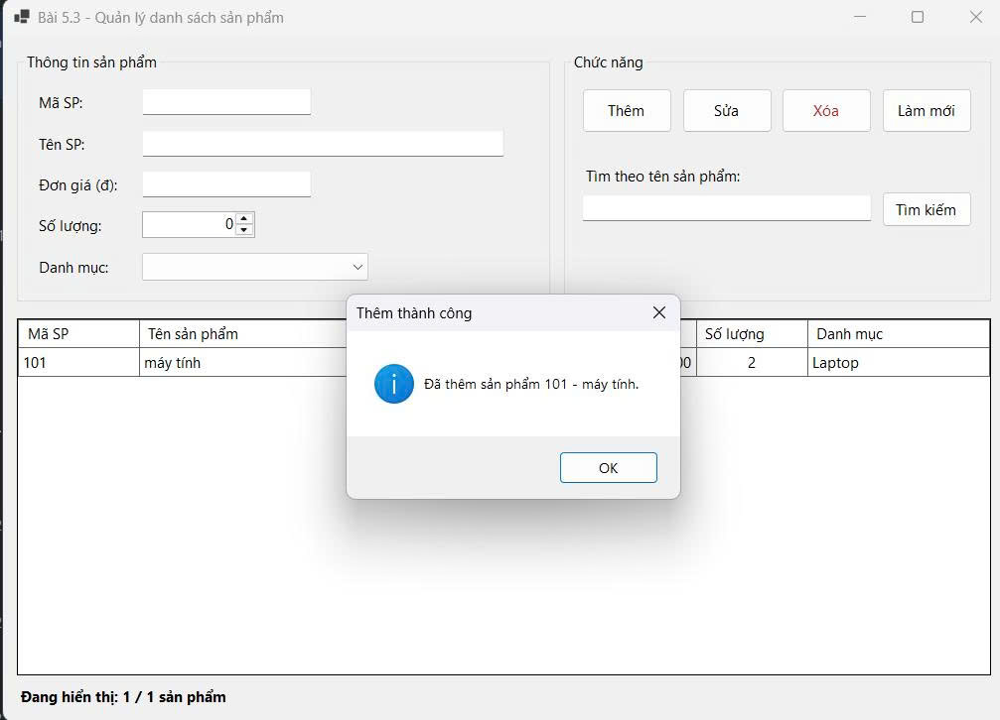
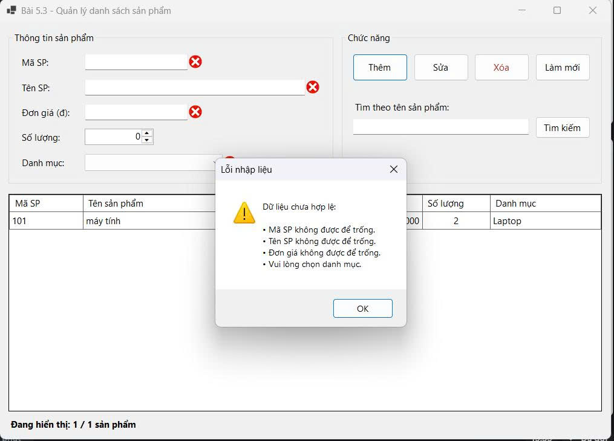
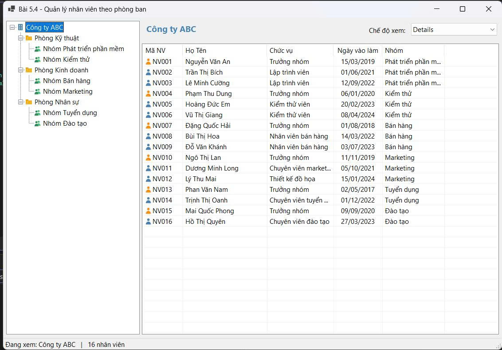

- **Họ và tên:** Đặng Hồng Thái
- **Mã số sinh viên:** 24810310241
- **Lớp:** D19CNPM3
- **Tên môn học:** Lập trình .Net
- **Tên bài tập:** Bài 5.1 – 5.4: ErrorProvider, ListBox & ComboBox, DataGridView, TreeView & ListView

---

## KẾT QUẢ THỰC HÀNH

### Bài 5.1: Form đăng ký tài khoản và bắt lỗi giao diện (ErrorProvider)

#### 1. Ảnh màn hình Giao diện chính

#### 2. Ảnh màn hình Chức năng thực thi / Kết quả

#### 3. Ảnh màn hình Kiểm tra lỗi (Validation)

---

### Bài 5.2: Bảng tính tiền dịch vụ và chiết khấu đơn hàng (ListBox & ComboBox)
#### 1. Ảnh màn hình Giao diện chính

#### 2. Ảnh màn hình Chức năng thực thi / Kết quả

#### 3. Ảnh màn hình Kiểm tra lỗi (Validation)

---

### Bài 5.3: Form quản lý danh sách sản phẩm trong bộ nhớ (DataGridView cơ bản)
#### 1. Ảnh màn hình Giao diện chính

#### 2. Ảnh màn hình Chức năng thực thi / Kết quả

#### 3. Ảnh màn hình Kiểm tra lỗi (Validation)

---

### Bài 5.4: Trình quản lý nhân viên theo phòng ban (TreeView & ListView)
#### 1. Ảnh màn hình Giao diện chính

