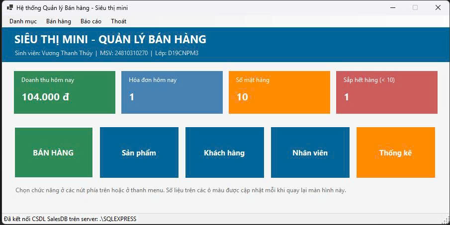
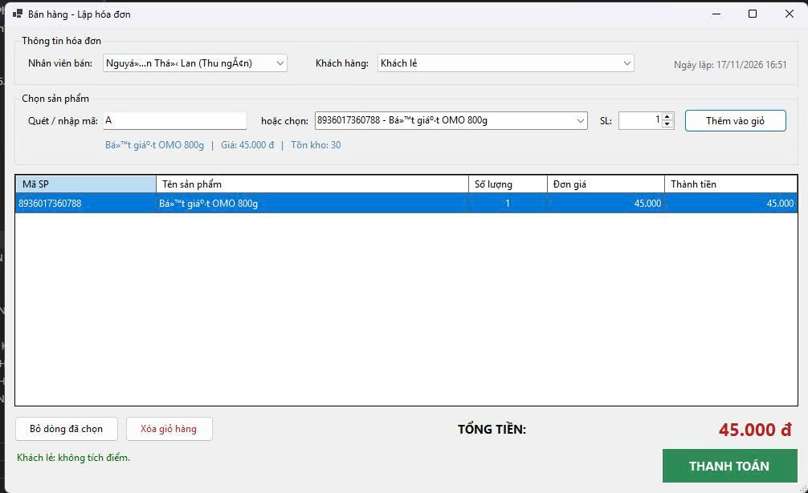
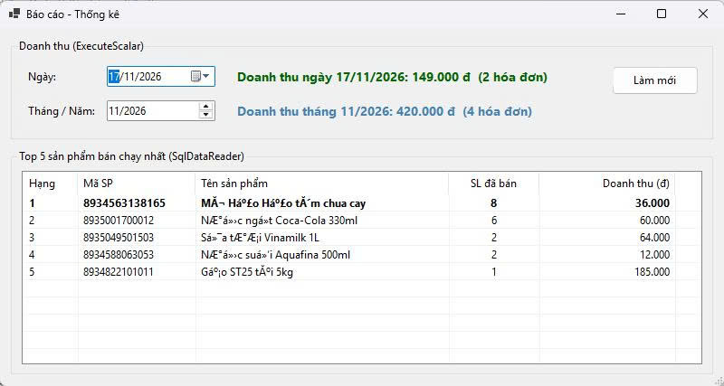
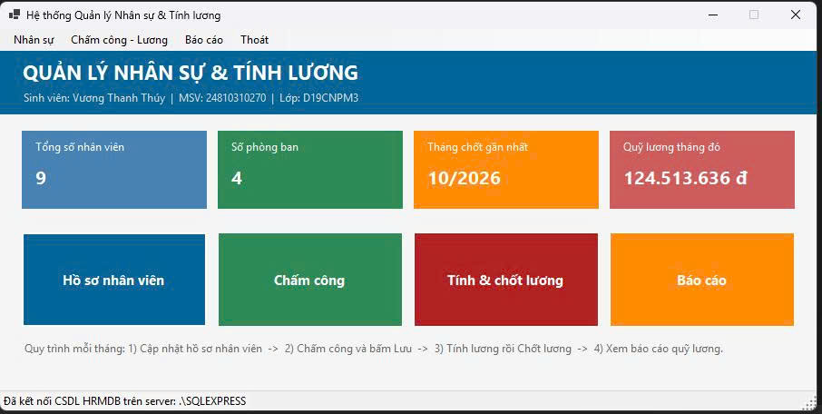
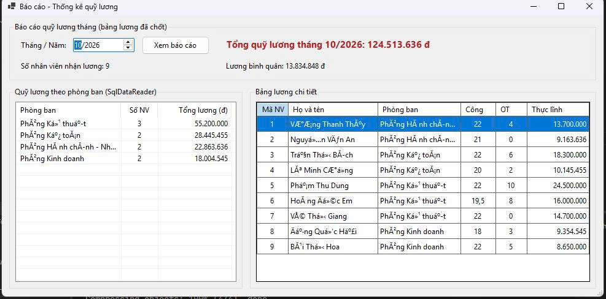

# BÀI 6.1 & 6.2: HỆ THỐNG QUẢN LÝ BÁN HÀNG VÀ HỆ THỐNG QUẢN LÝ NHÂN SỰ - TÍNH LƯƠNG

## MỤC 1: THÔNG TIN SINH VIÊN

- **Họ và tên sinh viên:** Đặng Hồng Thái
- **Mã sinh viên:** 24810310241
- **Lớp / Khóa:** D19CNPM3

## MỤC 2: HÌNH ẢNH KẾT QUẢ CÁC MÀN HÌNH CHỨC NĂNG

---

## BÀI 6.1: HỆ THỐNG QUẢN LÝ BÁN HÀNG & SIÊU THỊ MINI (RETAIL SALES SYSTEM)

### 1. Màn hình Chính / Tổng quan hệ thống

### 2. Màn hình Quản lý Danh mục (CRUD - Thêm/Sửa/Xóa)

### 3. Màn hình Báo cáo - Thống kê

---

## BÀI 6.2: HỆ THỐNG QUẢN LÝ NHÂN SỰ & TÍNH LƯƠNG (HRM & PAYROLL SYSTEM)

### 1. Màn hình Chính / Tổng quan hệ thống

### 2. Màn hình Quản lý Danh mục (CRUD - Thêm/Sửa/Xóa)

### 3. Màn hình Báo cáo - Thống kê

